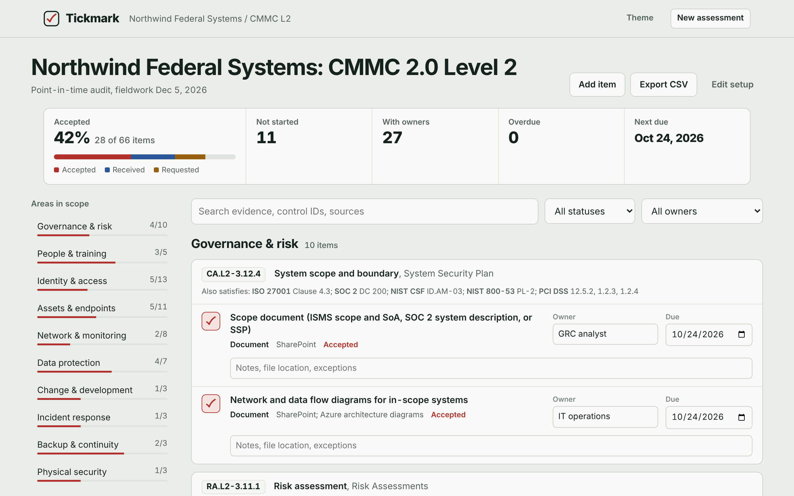
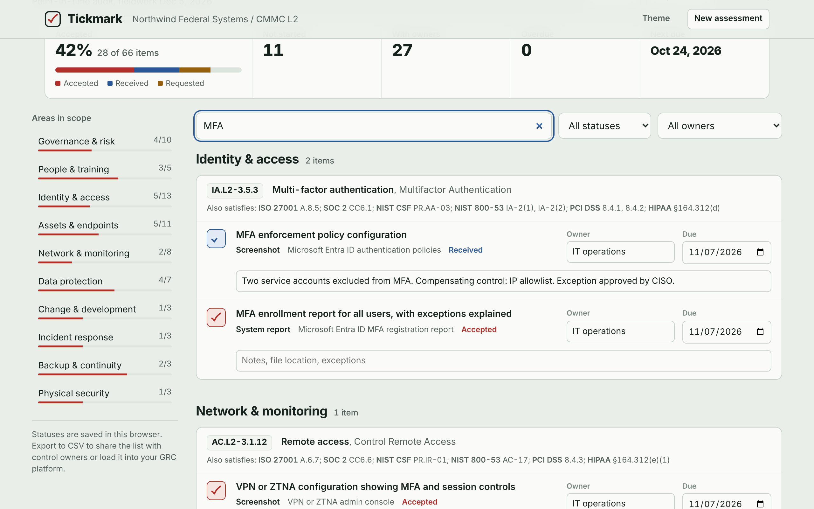

# Tickmark

**Audit evidence request lists for GRC teams.** Pick a framework, describe your environment, and get a tracked evidence list: every artifact mapped to its control, where to pull it from, who owns it, and when it is due.

**Live demo:** https://kaveryblake.github.io/tickmark/



## Why I built it

During audit prep at my company, evidence collection was the slowest part of the process. Someone rebuilt the same request list in a spreadsheet for every audit, chased owners by email, and re-collected artifacts that had already satisfied a different framework the quarter before. Tickmark is the tool I wanted during those ISO 27001 internal audits and our external compliance audit.

## What it does

- **Seven frameworks:** ISO/IEC 27001:2022, SOC 2 (Trust Services Criteria), NIST CSF 2.0, NIST SP 800-53 Rev. 5, CMMC 2.0 Level 2, PCI DSS v4.0.1, and the HIPAA Security Rule.
- **Scoped evidence lists:** choose the audit type, fieldwork date, headcount, areas in scope, and tool stack. Tickmark generates 60 to 85 evidence items with control IDs, evidence type, a named source system, a default owner, and a due date.
- **Cross-framework mapping:** each control shows what the same evidence also satisfies in the other six frameworks. Collect once, satisfy many.
- **Sampling guidance:** population-based items adapt to the audit type. Period-of-operation audits (SOC 2 Type II, surveillance) get full-population instructions for the review period. Point-in-time audits get recent-example guidance.
- **Tool-aware sources:** "Pull it from Microsoft Entra ID authentication policies" instead of "your identity provider." Sources update for Azure, AWS, Google Cloud, or on-premises.
- **Owner and due date logic:** owner titles scale with organization size. Due dates count back from fieldwork based on evidence type, since a policy takes longer to produce than a screenshot.
- **Tracking:** status per item (Not started, Requested, Received, Accepted, Not applicable), progress by area, overdue flags, search and filters, notes, and custom items.
- **CSV export:** hand the list to control owners or load it into a GRC platform.



## Framework coverage

| Framework | Version | Control IDs used | Notes |
|---|---|---|---|
| ISO/IEC 27001 | 2022 | Annex A (A.5 to A.8) and clauses 4 to 10 | |
| SOC 2 | TSC 2017 (revised points of focus 2022) | CC, A1, C1, DC 200 | Security, Availability, Confidentiality |
| NIST CSF | 2.0 | Function, category, subcategory (for example PR.AA-05) | Includes the Govern function |
| NIST SP 800-53 | Rev. 5 | Moderate baseline families | Enhancements noted, for example IA-2(1) |
| CMMC | 2.0 Level 2 | Practice IDs (for example AC.L2-3.1.1) | Maps to NIST SP 800-171 Rev. 2 |
| PCI DSS | v4.0.1 | Requirement numbers (for example 8.4.2) | Service-provider-only requirements are labeled |
| HIPAA Security Rule | 45 CFR 164.308 to 164.316 | CFR citations | Implementation specs tagged Required or Addressable |

## Mapping methodology

Tickmark is built around **evidence areas**, not individual controls. Each area (for example, user access reviews) represents one body of evidence an auditor would request, and maps to the control IDs it satisfies in every framework.

Mapping decisions follow a few rules from real audit work:

1. **Map to what an auditor would accept the artifact for.** A mapping appears only where the same artifact would close the request in that framework.
2. **Leave a gap when the framework has one.** PCI DSS does not require backups the way the other frameworks do, and the HIPAA Security Rule does not explicitly require change management or secure development. Those areas drop out instead of being force-mapped.
3. **Use official identifiers.** ISO Annex A numbers, TSC criteria, CSF 2.0 subcategories, 800-53 control and enhancement IDs, CMMC practice IDs, PCI DSS requirement numbers, and CFR citations.
4. **Core subset by design.** The library covers about 31 evidence areas that auditors request most often, not the full catalogs (110 CMMC practices or the full 800-53 catalog). The Add item flow handles anything else an auditor asks for.

Mappings can be checked against official crosswalks: NIST OLIR mappings for CSF 2.0 and SP 800-53, the CMMC Level 2 Assessment Guide, the AICPA TSC to ISO 27001 mapping, and the HHS HIPAA Security Rule crosswalk to the NIST Cybersecurity Framework.

## Built with

Plain HTML, CSS, and JavaScript. No framework, no build step, no backend. Everything runs in the browser and statuses are saved to local storage, so no data leaves the user's machine.

```
index.html     Page structure
styles.css     Layout, theming, light and dark mode
controls.js    Control library: frameworks, evidence areas, mappings, tool sources
app.js         Setup flow, list generation, tracking, export
```

To add a framework, add its names to `NAMES` and a key to each topic's `m` mapping in `controls.js`.

## Roadmap

- AI-assisted evidence requests and gap analysis through a rate-limited API proxy
- Full control catalogs as optional add-ons
- Import of an existing request list from CSV

## Disclaimer

Tickmark is a planning aid, not a substitute for the framework standards or your auditor's request list. Always confirm scope and requirements against the official documents.

## Author

**Keenan Blake**, IT Risk and Compliance. ISO 27001 and CMMC audit experience, M.S. in Cybersecurity.
